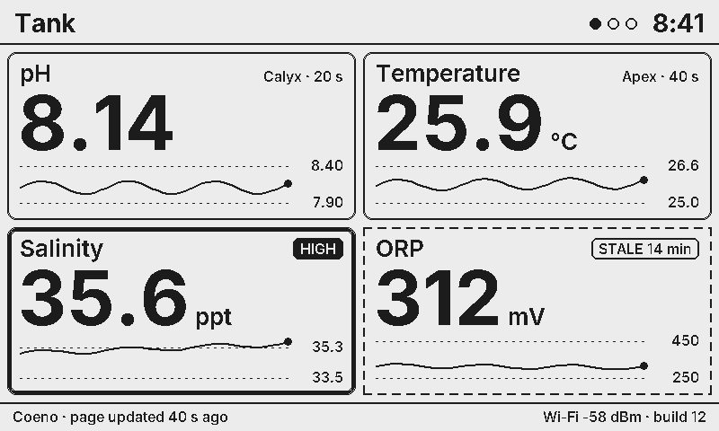
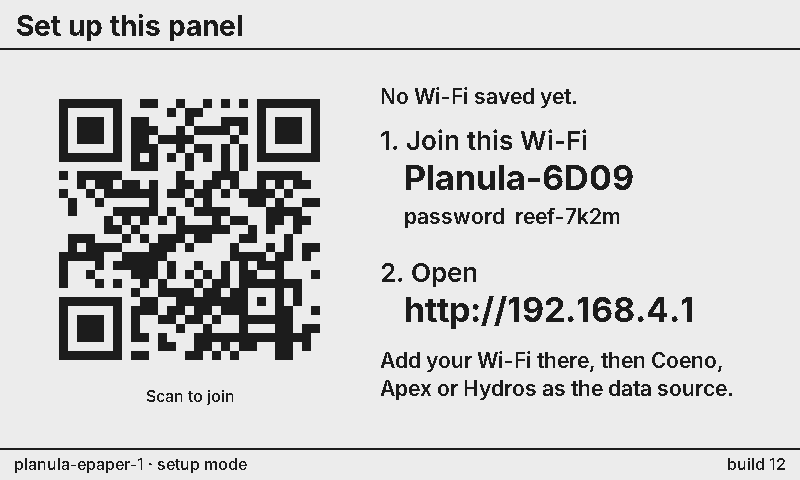
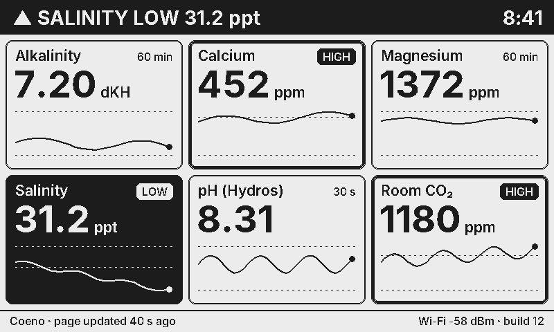

# Planula-ePaper

The Corallite wall gauge panel: a 7.5" black/white e-paper that shows any value in the reef system. Planula is the wireless line (the Calyx devices are wired). Low glare, no glow at night, and it keeps showing the last page if the power or network drops.



**Hardware:** Waveshare *e-Paper ESP32 Driver Board* Rev 3 (ESP32-WROOM-32E, USB-C) and the Waveshare 7.5" e-Paper raw panel V2, 800×480 B/W.

## Modes

| Mode | Where the pages come from | What's needed |
|---|---|---|
| **Coeno** (default) | Coeno builds every page: which gauges, normal bands, alarm limits, 24 h sparklines. It publishes them retained over MQTT and the panel only draws them. | Coeno on the LAN |
| **Direct** | The panel reads the **Apex** (local REST, Basic auth) and/or the **Hydros** (CoralVue cloud) itself. You pick gauges, pages and limits on the panel's own settings page. | Apex login and/or Hydros app login |

Coeno is still used in direct mode when a host is set: firmware updates, panel status and remote commands.

## First boot

1. Set the DIP switches **before** powering it with the panel attached:
   - **Switch 1 → A** (0.47 Ω, which Waveshare lists for the 7.5" panels). If the picture is faint or patchy, try B.
   - **Switch 2 → ON** (USB serial chip powered; needed to flash).
2. Flash it: `pio run -t upload` (the build pulls the toolchain and libraries itself).
3. With no Wi-Fi saved, the screen shows a QR code and **Planula-XXXX** with its password. Join it; your phone opens the settings page (or go to http://192.168.4.1).
4. Add your Wi-Fi, pick **Coeno** or **Direct**, and save. Once the panel joins your network, the settings page is at **http://planula-epaper-1.local** (or its IP; hold BOOT 3 s to show it on screen).



## The BOOT button

| Press | Does |
|---|---|
| short | acknowledge the alarm, or next page |
| hold 3 s | info screen: IP, settings address, source status |
| hold 10 s | open the setup Wi-Fi network |
| hold 25 s | erase all settings |

## Settings page (on the panel)

- **Panel**: live picture of the screen (`/screen.bmp`), page buttons, full refresh, flash to find it, status.
- **Wi-Fi**: up to 6 saved networks, scan, reorder. If none can be joined for 60 s, the setup network opens again.
- **Data source**: mode, Coeno address, **Apex** (address, user, password, poll interval, °F/°C, *Test login*), **Hydros** (e-mail, password, *Test login*).
- **Gauges** (direct mode): up to 6 pages (title, layout) and 40 gauges. Pick from every reading the Apex/Hydros reported, then set the label, unit, decimals, normal band and alarm limits. Picking pH/temp/salinity/ORP/alk/Ca/Mg fills in typical reef limits.
- **Display**: time zone, 12/24 h clock, °F, auto page rotation, stale time, full-refresh interval, panel driver (`t7` / `gdey`; some 7.5" V2 batches need the second one).
- **System**: name (also `<name>.local` and the Coeno id), settings password (HTTP basic auth, user `admin`), firmware check/install from Coeno, restart, erase.

Passwords are stored on the panel (NVS) and never sent back to the browser.

## What the screen does

- Layouts: 1 big gauge, 2–3 side by side, 2×2, 3×2, or a list (auto picks by count, or set it per page).
- Every tile shows the value, unit, source and age, and a 24 h sparkline with the normal band dashed.
- **Warn** (outside the normal band): thick border and a HIGH/LOW tag. **Alarm**: the tile inverts, a banner replaces the header, and the whole screen flashes when the alarm starts. Then one flash every 5 min until someone presses the button (or acks from Coeno). After the ack the banner is drawn hollow until the value is back in range.
- **Stale**: values older than the stale time get a dashed border and "STALE 14 min". If Coeno stops sending pages or goes offline, the footer turns black and says so. Old values are never shown as current.
- Refresh: partial (no flash, < 1 s) when something visible changes, at most once a minute. Full (flashing) refresh after 60 partials or hourly, to clear ghosting. The panel's voltages are switched off between updates.



## Coeno protocol (`PanelNode` in coeno `protocol/topics.py`)

```
Coeno → panel   panel_node/<name>/page/<n>     retained page JSON (n = 0..5)
                panel_node/<name>/config       retained {"pages": n, "rotate_s": s}
                panel_node/<name>/cmd/<what>   next | page {n} | refresh {full} | identify | check | update | ack
panel → Coeno   panel_node/<name>/hello        retained, LWT {"online": false}
                panel_node/<name>/state        retained every 60 s (page, alarms, rssi, build, available_build, …)
                panel_node/<name>/ack          {"ids": [...]} when the button acknowledges an alarm
```

Page JSON (parsed by `lib/panel/src/PageJson.cpp`):

```json
{"v": 1, "title": "Tank", "layout": "auto",
 "gauges": [{"id": "tank:ph", "label": "pH", "value": 8.12, "dec": 2, "unit": "",
             "src": "Hydros", "status": "ok", "note": "", "age_s": 30,
             "lo": 7.9, "hi": 8.4, "spark": [8.10, 8.11, 8.12]}]}
```

On the Coeno side, `coeno/services/panel_pages.py` builds the pages every 60 s and `/api/panel-nodes/*` configures them. A panel that says hello gets the default *Tank* and *Chemistry* pages until it is given its own.

## Direct-mode details

- **Apex**: `GET http://<apex>/rest/status` with Basic auth (same call Coeno makes). Only `inputs` are kept (a JSON filter, so a large status doesn't run the board out of memory). Temperatures are converted to °C (°F detected from the value or set explicitly).
- **Hydros**: the same cloud path as Coeno's `hydros_service` / pyhydros. A Cognito `USER_PASSWORD_AUTH` login gets an ID token. Then `cv.hydros.link/user` gives the controllers, `/thing/<id>` the Cognito identity and AWS IoT endpoint, and `GetCredentialsForIdentity` temporary keys. The panel then opens MQTT over a SigV4-signed WebSocket (`lib/sigv4`, checked against AWS's published example). It subscribes `<user>/<thing>/rsp/#` and requests `.../req/LISTEN/statusc`. Payloads may be zlib behind a short header (inflated with the ESP32's ROM miniz). The session is rebuilt every 50 min and after 10 min of silence.
- Each value keeps a 24 h trend in RAM (one point per 30 min) for the sparklines; it starts empty after a restart.

## Building and testing

```
pio run                      # firmware (Arduino core 3.0.7 via pioarduino, same pin as the Calyx nodes)
pio run -t upload            # USB
pio run -e epaper-net -t upload   # over Wi-Fi (needs CALYX_OTA_PASS, same as the running build)
tools/host/render.sh         # renders sample screens to tools/host/out/*.png and runs the logic tests
./publish.sh                 # build + stage the .bin in ../coeno/firmware/planula-epaper/ for OTA
```

`lib/panel` (model, text, layouts, page JSON, status rules) has no ESP32 code. The host renderer draws the exact same frames as the panel, which is where `docs/screens/` comes from.

Layout:

```
src/main.cpp          loop: pages, alarms, button, updates
src/Display.*         GxEPD2 driver, refresh policy, alarm flash, BMP for the web page
src/Net.*             Wi-Fi (multi-network), setup network + captive portal, mDNS, NTP
src/Web.*, web/       settings page + JSON API (web/index.html is embedded at build time)
src/Settings.*        NVS settings (one JSON blob)
src/CoenoLink.*       MQTT to Coeno (esp-mqtt)
src/Apex.*, Hydros.*  direct-mode sources; src/Readings.* the values they produce
src/DirectPages.*     direct-mode page builder
lib/panel             rendering + page model (host-testable)
lib/sigv4             AWS SigV4 presigning (host-testable)
lib/qrcodegen         Nayuki QR Code generator (MIT)
lib/ota               pull OTA from Coeno with SHA-256 and rollback (shared with the Calyx nodes)
tools/mkfonts.py      Inter → Adafruit GFX fonts (adds °, µ, ³, ₂, —, ·, ▲, ▼)
```

## Not verified on hardware yet

Written and compiled, but not yet run on the board:

- First light: which driver (`t7` or `gdey`) suits this panel, and whether switch 1 needs A or B.
- Hydros cloud login and the IoT stream from the panel (the steps mirror pyhydros; the AWS IoT WebSocket path and the payload format are the parts to watch).
- Apex `/rest/status` against your firmware.
- Whether GPIO2 drives the board's "LED" (not used yet).

Fonts: Inter, SIL Open Font License 1.1. QR code: Nayuki, MIT.
