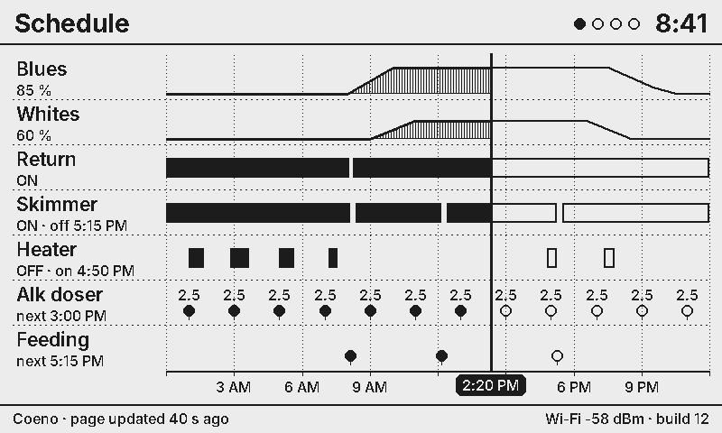
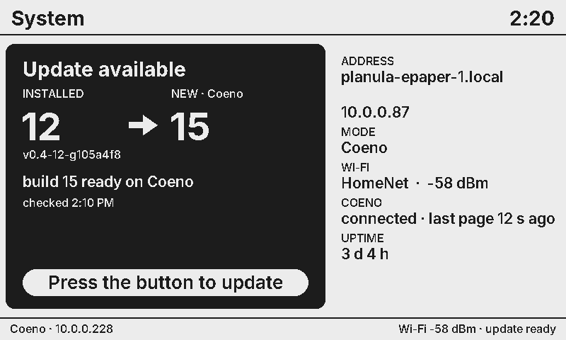

# Planula-ePaper

The Corallite wall gauge panel: a 7.5" black/white e-paper that shows any value in the reef system. Planula is the wireless line (the Calyx devices are wired). Low glare, no glow at night, and it keeps showing the last page if the power or network drops.


**Hardware:** Waveshare *e-Paper ESP32 Driver Board* Rev 3 (ESP32-WROOM-32E, USB-C) and the Waveshare 7.5" e-Paper raw panel V2, 800×480 B/W.

## Modes

| Mode | Where the pages come from | What's needed |
|---|---|---|
| **Coeno** (default) | Coeno builds every page: which gauges, normal bands, alarm limits, 24 h sparklines. It publishes them retained over MQTT and the panel only draws them. | Coeno on the LAN |
| **Direct** | The panel reads the **Apex** (local REST, Basic auth) and/or the **Hydros** (CoralVue cloud) itself. You pick gauges, pages and limits on the panel's own settings page. | Apex login and/or Hydros app login |

Coeno is still used in direct mode when a host is set: firmware updates, panel status and remote commands.

## First boot

1. Set the DIP switches **before** powering it with the panel attached:
   - **Switch 1 → A** (0.47 Ω, which Waveshare lists for the 7.5" panels). If the picture is faint or patchy, try B.
   - **Switch 2 → ON** (USB serial chip powered; needed to flash).
2. Flash it: `pio run -t upload` (the build pulls the toolchain and libraries itself).
3. With no Wi-Fi saved, the screen shows a QR code and **Planula-XXXX** with its password. Join it; your phone opens the settings page (or go to http://192.168.4.1).
4. Add your Wi-Fi, pick **Coeno** or **Direct**, and save. Once the panel joins your network, the settings page is at **http://planula-epaper-1.local** (or its IP; hold BOOT 3 s to show it on screen).


## The BOOT button

| Press | Does |
|---|---|
| short | acknowledge the alarm, or next page. On the System screen: install the update (or retry it), else close |
| hold 3 s | **System** screen (firmware + update state, address, sources). Held again while it's up: check for updates now. Without Coeno linked: info screen only (address, sources, build) |
| hold 10 s | open the setup Wi-Fi network |
| hold 25 s | erase all settings |

## Settings page (on the panel)

- **Panel**: live picture of the screen (`/screen.bmp`), page buttons, full refresh, flash to find it, status.
- **Wi-Fi**: up to 6 saved networks, scan, reorder. If none can be joined for 60 s, the setup network opens again.
- **Data source**: mode, Coeno address, **Apex** (address, user, password, poll interval, °F/°C, *Test login*), **Hydros** (e-mail, password, *Test login*).
- **Gauges** (direct mode): up to 6 pages (title, layout) and 40 gauges. Pick from every reading the Apex/Hydros reported, then set the label, unit, decimals, normal band and alarm limits. Picking pH/temp/salinity/ORP/alk/Ca/Mg fills in typical reef limits.
- **Display**: time zone, 12/24 h clock, °F, auto page rotation, stale time, full-refresh interval, panel driver (`t7` / `gdey`; some 7.5" V2 batches need the second one).
- **System**: name (also `<name>.local` and the Coeno id), settings password (HTTP basic auth, user `admin`), firmware check/install from Coeno, restart, erase.

Passwords are stored on the panel (NVS) and never sent back to the browser.

## What the screen does

- Layouts: 1 big gauge, 2–3 side by side, 2×2, 3×2, or a list (auto picks by count, or set it per page).
- Every tile shows the value, unit, source and age, and a 24 h sparkline with the normal band dashed.
- **Warn** (outside the normal band): thick border and a HIGH/LOW tag. **Alarm**: the tile inverts, a banner replaces the header, and the whole screen flashes when the alarm starts. Then one flash every 5 min until someone presses the button (or acks from Coeno). After the ack the banner is drawn hollow until the value is back in range.
- **Stale**: values older than the stale time get a dashed border and "STALE 14 min". If Coeno stops sending pages or goes offline, the footer turns black and says so. Old values are never shown as current.
- Refresh: partial (no flash, < 1 s) when something visible changes, at most once a minute. Full (flashing) refresh after 60 partials or hourly, to clear ghosting. The panel's voltages are switched off between updates.


### Schedule (timeline) pages

**Coeno mode only** (Coeno builds the lanes; a direct-mode page set to timeline falls back to auto). `"layout": "timeline"`: each gauge is a lane, time runs across, a black line marks now. What already happened is drawn solid (hatched under a ramp, filled bars, filled dots); what is scheduled is drawn hollow. Up to 10 lanes and 48 points per lane.

| Lane `kind` | For | Drawn as | Label cell says |
|---|---|---|---|
| `level` | light ramps, pump speed % | ramping line | current value, `85 %` |
| `step` | setpoints, modes | line that holds until the next point | current value |
| `onoff` (or `spans`) | outlets, ATO, heater, feed mode | bars | `ON · off 5:15 PM` |
| `events` | doser shots, feedings | dots with the amount above | `next 3:00 PM` |

The window is today (`"window": "day"`, midnight to midnight) or `from`/`to` minutes around now (default ±12 h). With `clock` (local minutes after midnight) the axis shows clock time (12/24 h follows the Display setting); without it, `-6 h … +6 h`. "Now" moves on between Coeno's pages.



```json
{"v": 1, "title": "Schedule", "layout": "timeline", "window": "day", "clock": 860,
 "gauges": [
  {"id": "apex:Blues", "label": "Blues", "kind": "level", "unit": "%", "dec": 0,
   "pts": [[-860, 0], [-380, 0], [-260, 85], [310, 85], [430, 20], [490, 0]]},
  {"id": "apex:Return", "label": "Return", "kind": "onoff", "value": 1, "spans": [[-860, -375], [-365, 580]]},
  {"id": "e4:alk", "label": "Alk doser", "kind": "events", "unit": "mL", "dec": 1,
   "pts": [[-80, 2.5], [40, 2.5], [160, 2.5]]}]}
```
Times are minutes from the page's now (negative = happened). `pts` are `[minutes, value]`; `spans` are `[on, off]` pairs.

### System screen and updates

**Only when Coeno is linked for updates** (Coeno host set and *Coeno updates* on, in either mode); otherwise the 3 s hold shows the plain info screen and the panel offers no updates on screen (the settings page still can). Hold the button 3 s. The left card shows the update state; the right column shows the address, mode, Wi-Fi and source status. When a newer build is on Coeno or GitHub the card turns black and **pressing the button installs it**; a progress bar follows (partial refresh every 10 %), then the panel restarts into the new build (rolls back by itself if it doesn't come up). A failed install opens this screen for 2 min with the reason; the footer says `update ready, hold 3 s` whenever one is waiting.



## Coeno protocol (`PanelNode` in coeno `protocol/topics.py`)

```
Coeno → panel   panel_node/<name>/page/<n>     retained page JSON (n = 0..5)
                panel_node/<name>/config       retained {"pages": n, "rotate_s": s}
                panel_node/<name>/cmd/<what>   next | page {n} | refresh {full} | identify | check | update | ack
panel → Coeno   panel_node/<name>/hello        retained, LWT {"online": false}
                panel_node/<name>/state        retained every 60 s (page, alarms, rssi, build, available_build, …)
                panel_node/<name>/ack          {"ids": [...]} when the button acknowledges an alarm
```

Page JSON (parsed by `lib/panel/src/PageJson.cpp`):

```json
{"v": 1, "title": "Tank", "layout": "auto",
 "gauges": [{"id": "tank:ph", "label": "pH", "value": 8.12, "dec": 2, "unit": "",
             "src": "Hydros", "status": "ok", "note": "", "age_s": 30,
             "lo": 7.9, "hi": 8.4, "spark": [8.10, 8.11, 8.12]}]}
```

On the Coeno side, `coeno/services/panel_pages.py` builds the pages every 60 s and `/api/panel-nodes/*` configures them. A panel that says hello gets the default *Tank* and *Chemistry* pages until it is given its own.

## Direct-mode details

- **Apex**: `GET http://<apex>/rest/status` with Basic auth (same call Coeno makes). Only `inputs` are kept (a JSON filter, so a large status doesn't run the board out of memory). Temperatures are converted to °C (°F detected from the value or set explicitly).
- **Hydros**: the same cloud path as Coeno's `hydros_service` / pyhydros. A Cognito `USER_PASSWORD_AUTH` login gets an ID token. Then `cv.hydros.link/user` gives the controllers, `/thing/<id>` the Cognito identity and AWS IoT endpoint, and `GetCredentialsForIdentity` temporary keys. The panel then opens MQTT over a SigV4-signed WebSocket (`lib/sigv4`, checked against AWS's published example). It subscribes `<user>/<thing>/rsp/#` and requests `.../req/LISTEN/statusc`. Payloads may be zlib behind a short header (inflated with the ESP32's ROM miniz). The session is rebuilt every 50 min and after 10 min of silence.
- Each value keeps a 24 h trend in RAM (one point per 30 min) for the sparklines; it starts empty after a restart.
- **Where the network work runs**: `loop()` only draws, serves the settings page and reads the button. Apex polls, Hydros logins, update checks and downloads, and the Test buttons are queued to one background task (`src/Worker.*`) and run one at a time, so a slow Apex or login never freezes the page.
- **One TLS connection at a time**: there's RAM for one (~40 kB). Every `https::` call takes a token (`tls::acquire`); the Hydros AWS session keeps it while it runs and steps aside when something else asks, then logs in again. Calling `https::` from `loop()` fails at once and logs `[tls] … called from loop()`.

## Building and testing

```
pio run                      # firmware (Arduino core 3.0.7 via pioarduino, same pin as the Calyx nodes)
pio run -t upload            # USB
pio run -e epaper-net -t upload   # over Wi-Fi (needs CALYX_OTA_PASS, same as the running build)
tools/host/render.sh         # renders sample screens to tools/host/out/*.png and runs the logic tests
./publish.sh                 # build + stage the .bin in ../coeno/firmware/planula-epaper/ for OTA
```

**Updates.** Every push to main is built by `.github/workflows/release.yml` and published as a GitHub release
`build-<N>` (with `latest.json`). The panel checks Coeno first (`http://<coeno>:8000/firmware/planula-epaper/latest.json`).
When Coeno doesn't answer (another network, Coeno down, nothing published there), it checks the GitHub release
instead. It checks every 6 h, or on *Check now* (System page). *Install update* installs from whichever source
had it. *Install new builds by itself* makes it install automatically, never during an alarm. You can also
upload a `firmware.bin` from the System page, or use `pio run -e epaper-net -t upload` from the Mac (only when
the running build was made with `CALYX_OTA_PASS` set; public release builds don't listen for it). Coeno and
GitHub updates are SHA-256 checked, and any new build that doesn't get on Wi-Fi and draw within 120 s rolls back.

`lib/panel` (model, text, layouts, page JSON, status rules) has no ESP32 code. The host renderer draws the exact same frames as the panel, which is where `docs/screens/` comes from.

Layout:

```
src/main.cpp          loop: pages, alarms, button, updates
src/Display.*         GxEPD2 driver, refresh policy, alarm flash, BMP for the web page
src/Net.*             Wi-Fi (multi-network), setup network + captive portal, mDNS, NTP
src/Web.*, web/       settings page + JSON API (web/index.html is embedded at build time)
src/Settings.*        NVS settings (one JSON blob)
src/CoenoLink.*       MQTT to Coeno (esp-mqtt)
src/Apex.*, Hydros.*  direct-mode sources; src/Readings.* the values they produce
src/DirectPages.*     direct-mode page builder
lib/panel             rendering + page model (host-testable)
lib/sigv4             AWS SigV4 presigning (host-testable)
lib/qrcodegen         Nayuki QR Code generator (MIT)
lib/ota               pull OTA from Coeno with SHA-256 and rollback (shared with the Calyx nodes)
tools/mkfonts.py      Inter → Adafruit GFX fonts (adds °, µ, ³, ₂, —, ·, ▲, ▼)
```

## Verified on hardware (Waveshare board, builds 1-19)

Driver `t7` with switch 1 on A; Hydros cloud login and IoT stream; Apex `/rest/status` (AC6 5.16_AC26, through an SSH tunnel).
Still open: GPIO2 "LED" (unused), runs longer than ~20 min.

## Seeed reTerminal E1001 (`env:reterminal`, compiles, not yet run)

Pins from Seeed's docs; whole frame in PSRAM; own firmware image (`planula-epaper-s3`, GitHub `latest-s3.json`).

Planned once the unit is here (decided 2026-10-29):

- **Buttons**: left / right = previous / next page. Refresh: short = acknowledge alarm and silence the buzzer, or fetch now; hold 3 s = info screen; hold 10 s = setup network. Left + right held = factory reset. Any button wakes it from sleep. (Right is GPIO5; the other two pins still to find.)
- **Power modes** (Settings):
  - **Live**: wall power, as today.
  - **Saver**: wake every few minutes; redraw only when a value moves more than a step (pH 0.02, temp 0.1°, salinity 0.1 ppt, ORP 5 mV) or a status changes, and at least hourly. Shows "updated 10:40", not a running clock.
  - **Daily**: one update a day at a set time, plus any button press, plus an **hourly alarm check**: wake for a few seconds, compare against alarm limits, sleep again without touching the screen unless something is out of range (then redraw with the alarm tile and beep). The screen says plainly how old the readings are ("Readings from 7:00 this morning").
  - Battery wakes go through Coeno or Apex (seconds on the LAN). Hydros direct needs a 10-20 s cloud login per wake, so it suits Live mode, or Coeno doing the Hydros side.
- SHT40 room temperature / humidity as gauges; buzzer for alarms.

Fonts: Inter, SIL Open Font License 1.1. QR code: Nayuki, MIT.
