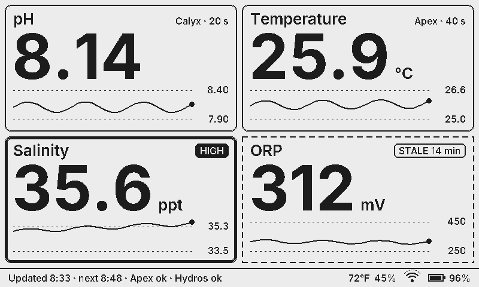
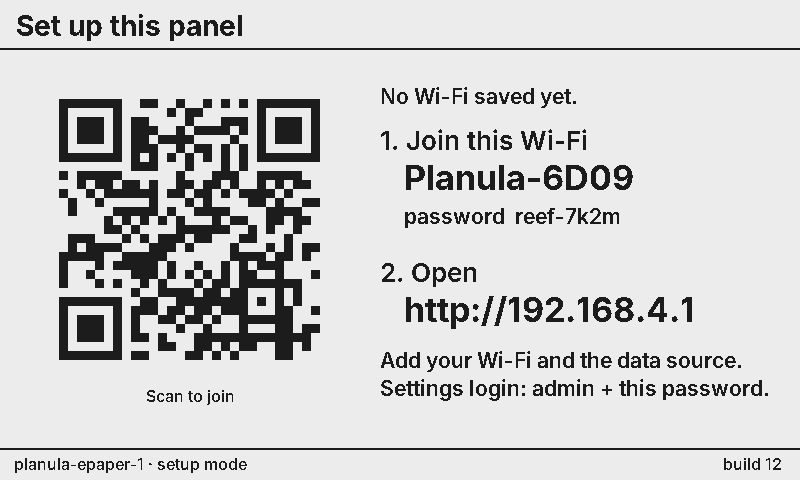
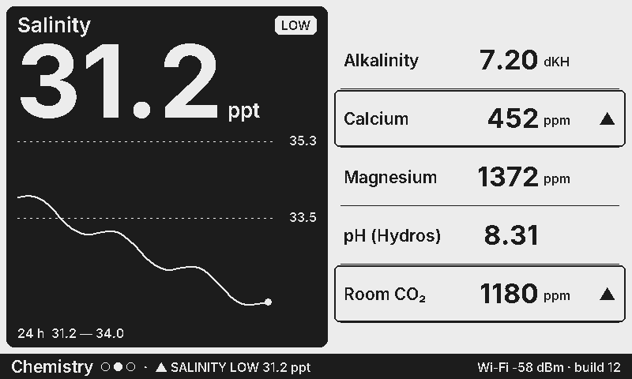
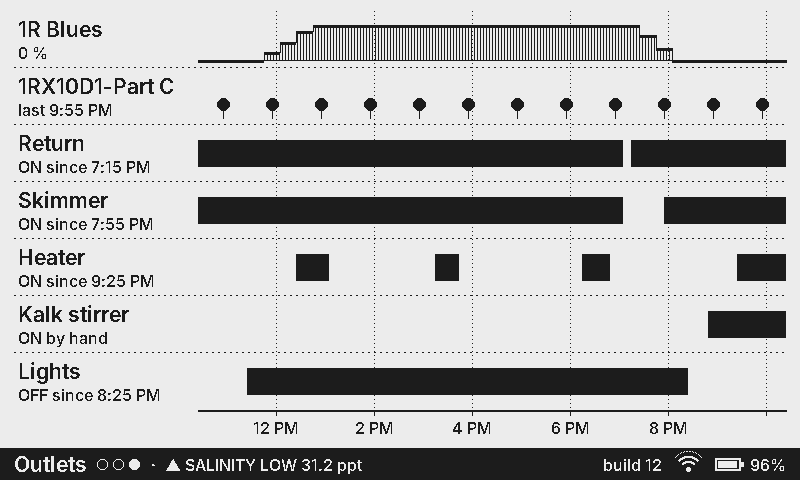
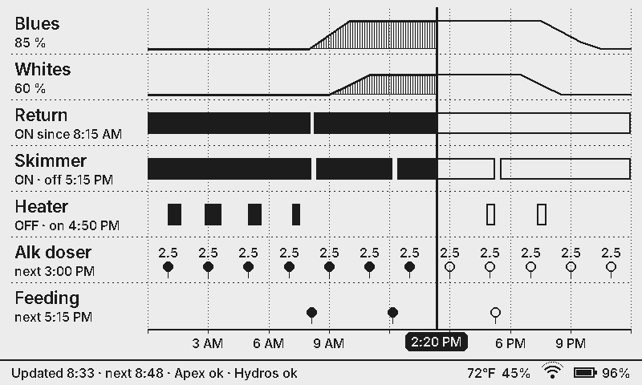
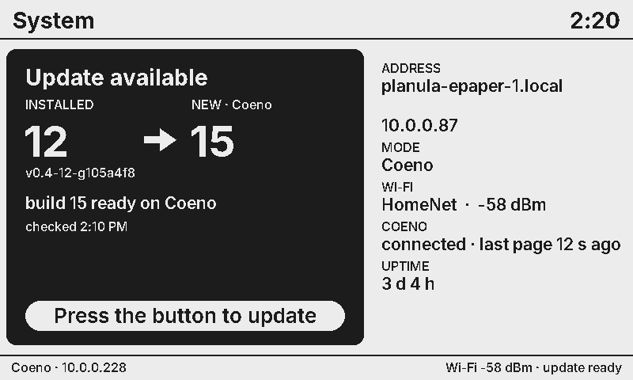

# Planula-ePaper

The Corallite wall gauge panel: a 7.5" black/white e-paper that shows any value in the reef system. Planula is the wireless line (the Calyx devices are wired). Low glare, no glow at night, and it keeps showing the last page if the power or network drops.



**Hardware**, two builds of the same firmware:

| Build | Board | Notes |
|---|---|---|
| `env:epaper` | Waveshare *e-Paper ESP32 Driver Board* Rev 3 (ESP32-WROOM-32E, USB-C) + Waveshare 7.5" V2 raw panel, 800×480 B/W | one BOOT button, wall power, ~300 kB RAM (the frame is drawn in 120-row strips) |
| `env:reterminal` | Seeed **reTerminal E1001** (ESP32-S3, 8 MB PSRAM, 7.5" 800×480 B/W, case, 2000 mAh battery) | three buttons, buzzer, SHT4x room sensor, battery power modes |

## Modes

| Mode | Where the pages come from | What's needed |
|---|---|---|
| **Coeno** | Coeno builds every page: which gauges, normal bands, alarm limits, 24 h sparklines. It publishes them retained over MQTT and the panel only draws them. | Coeno on the LAN |
| **Direct** (default for new panels) | The panel reads the **Apex** (local REST, Basic auth) and/or the **Hydros** (CoralVue cloud) itself. You pick gauges, pages and limits on the panel's own settings page. | Apex login and/or Hydros app login |

Coeno is still used in direct mode when a host is set: firmware updates, panel status and remote commands.
The Coeno address starts **blank**: a new panel is standalone (screen says so, no connection attempts, updates from GitHub) until you set it. Panels that already had one keep it.

## First boot

1. Set the DIP switches **before** powering it with the panel attached:
   - **Switch 1 → A** (0.47 Ω, which Waveshare lists for the 7.5" panels). If the picture is faint or patchy, try B.
   - **Switch 2 → ON** (USB serial chip powered; needed to flash).
2. Flash it: `pio run -t upload` (the build pulls the toolchain and libraries itself).
3. With no Wi-Fi saved, the screen shows a QR code and **Planula-XXXX** with its password. Join it; your phone opens the settings page (or go to http://192.168.4.1).
4. Add your Wi-Fi, pick **Coeno** or **Direct**, and save. The settings login is user **admin** with the same password as the setup network (no prompt while you're on the setup network itself). Once the panel joins your network, the settings page is at **http://planula-epaper-1.local** (or its IP; hold BOOT 3 s to show it on screen).



## Buttons

### reTerminal: three buttons, set under Display → Buttons

Each button has a short-press action and a 3 s hold action (on release): previous / next page, switch view, the Outlets / Schedule page (and back), "go to page N (and back)" for each page, fresh readings now, System screen, nothing. Defaults: left = previous page, middle = switch view (held: System screen; held again there: check for updates), right = next page. While an alarm is showing, the first press of the middle button (or any button, if set) acknowledges it and stops the beeps. Fixed: middle held 10 s = setup network, left + right held 10 s = erase settings. On battery, the press that wakes the panel only wakes it.

Pins (Seeed): KEY0 GPIO3 right (green), KEY1 GPIO4 middle, KEY2 GPIO5 left, active low; buzzer GPIO45; LED GPIO6; SHT4x 0x44 on SDA 19 / SCL 20; battery GPIO1 (1:2 divider) gated by GPIO21; microSD CS 14 (held high, it shares the bus).

### Waveshare board: the BOOT button

| Press | Does |
|---|---|
| short | acknowledge the alarm, or next page. On the System screen: install the update (or retry it), else close |
| hold 3 s | **System** screen (firmware + update state, address, sources). Held again while it's up: check for updates now. Without Coeno linked: info screen only (address, sources, build) |
| hold 10 s | open the setup Wi-Fi network |
| hold 25 s | erase all settings |

## Settings page (on the panel)

- **Panel**: live picture of the screen (`/screen.bmp`), page buttons, full refresh, flash to find it, status.
- **Wi-Fi**: up to 6 saved networks, scan, reorder. If none can be joined for 60 s, the setup network opens again.
- **Data source**: mode, Coeno address, **Apex** (address, user, password, poll interval, °F/°C, *Test login*), **Hydros** (e-mail, password, *Test login*).
- **Gauges** (direct mode): up to 6 pages (title, layout) and 40 gauges. Pick from every reading the Apex/Hydros reported, then set the label, unit, decimals, normal band and alarm limits. Picking pH/temp/salinity/ORP/alk/Ca/Mg fills in typical reef limits.
- **Display**: time zone, 12/24 h clock, °F, tile view (number + trend / graphs / numbers only), page rotation (buttons only, every 2, 5, 15, 30, 60 min or 2 h), stale time, full-refresh interval, panel driver (`t7` / `gdey`; some 7.5" V2 batches need the second one). reTerminal only: **Power** (Live / Saver / Daily), **Beep on alarms**, **Buttons**.
- **System**: name (also `<name>.local` and the Coeno id), settings password (HTTP basic auth, user `admin`; defaults to the board's setup Wi-Fi password, never blank; erasing settings keeps that password so a printed label stays valid), firmware check/install from Coeno, restart, erase.

Passwords are stored on the panel (NVS) and never sent back to the browser. Everything needs the login except next page / refresh (`POST /api/page`, `/api/refresh`), which stay open like the button.

## What the screen does

- Gauge pages have **no header**: the page title and page dots sit at the left of the footer, then the status (`Apex ok · Hydros ok`), and Wi-Fi bars and battery as icons on the right. The tiles get the full height.
- Layouts: 1 big gauge, 2–3 side by side, 2×2, 3×2, or a list (auto picks by count, or set it per page).
- **Views** (Display setting, the Switch view button, or a reTerminal button):
  - *Number and trend*: value, unit, source and age, with the 24 h sparkline and the normal band dashed.
  - *Graphs*: the trend fills the tile, with `24 h  397 – 399` (low – high, including the current value) under it.
  - *Numbers only*: each value centred and as big as the tile allows, unit in the lower-right corner; values of 100+ drop decimals.
  One tile gets 240 px digits, two side by side 150 px (BigFont: past Adafruit GFX's ~128 px limit).
- Trends have a minimum height per unit (5 % humidity, 0.1 pH, 1 °F / 0.5 °C, 0.5 ppt, 20 mV …) so noise draws flat.
- **Warn** (outside the normal band): thick border and a HIGH/LOW tag. **Alarm** (past an alarm limit): with one or two alarms on a page, an **alarm takeover**: they get the left half (big value + 24 h trend) and the rest becomes a compact list on the right (three or more: the normal grid with black tiles). The footer turns black with the alarm text, the screen flashes when it starts, then every 5 min (and on the reTerminal three beeps) until acknowledged. After the ack the footer says "· acknowledged".
- **Stale**: values older than the stale time get a dashed border and "STALE 14 min". If Coeno stops sending pages or goes offline, the footer turns black and says so. Old values are never shown as current.
- Refresh: partial (no flash, < 1 s) when something visible changes, at most once a minute; at once when a gauge gets its first value. Full (flashing) refresh after 60 partials, hourly, or when the screen changes (page, view). The panel's voltages are switched off between updates.



### Outlets page (direct mode)

Gauges tab → *Outlets page*: every output the Apex (`outputs`, ON/OFF = by hand, AON/AOF = auto) and the Hydros (`Output.<name>.valueState` 0–10000, `override` = by hand) report, with its live state; virtual / alert outputs hidden unless asked. Tick up to 8: they become a page after the gauge pages, 12 h up to now: on/off bars, dimmable outputs as their level (%), dosing heads as a mark per dose. `ON since 7:15 PM` / `OFF by hand` under each name. Past only (the controllers don't share their programs) and empty after a restart; in Coeno mode the Schedule page below shows the future too.



### Schedule (timeline) pages

**Coeno mode** (Coeno builds the lanes; a direct-mode gauge page set to timeline falls back to auto). `"layout": "timeline"`: each gauge is a lane, time runs across, a black line marks now. What already happened is drawn solid (hatched under a ramp, filled bars, filled dots); what is scheduled is drawn hollow. Up to 10 lanes and 48 points per lane.

| Lane `kind` | For | Drawn as | Label cell says |
|---|---|---|---|
| `level` | light ramps, pump speed % | ramping line | current value, `85 %` |
| `step` | setpoints, modes | line that holds until the next point | current value |
| `onoff` (or `spans`) | outlets, ATO, heater, feed mode | bars | `ON · off 5:15 PM` |
| `events` | doser shots, feedings | dots with the amount above | `next 3:00 PM` |

The window is today (`"window": "day"`, midnight to midnight) or `from`/`to` minutes around now (default ±12 h). With `clock` (local minutes after midnight) the axis shows clock time (12/24 h follows the Display setting); without it, `-6 h … +6 h`. "Now" moves on between Coeno's pages.



```json
{"v": 1, "title": "Schedule", "layout": "timeline", "window": "day", "clock": 860,
 "gauges": [
  {"id": "apex:Blues", "label": "Blues", "kind": "level", "unit": "%", "dec": 0,
   "pts": [[-860, 0], [-380, 0], [-260, 85], [310, 85], [430, 20], [490, 0]]},
  {"id": "apex:Return", "label": "Return", "kind": "onoff", "value": 1, "spans": [[-860, -375], [-365, 580]]},
  {"id": "e4:alk", "label": "Alk doser", "kind": "events", "unit": "mL", "dec": 1,
   "pts": [[-80, 2.5], [40, 2.5], [160, 2.5]]}]}
```
Times are minutes from the page's now (negative = happened). `pts` are `[minutes, value]`; `spans` are `[on, off]` pairs.

### System screen and updates

**Only when Coeno is linked for updates** (Coeno host set and *Coeno updates* on, in either mode); otherwise the 3 s hold shows the plain info screen and the panel offers no updates on screen (the settings page still can). Hold the button 3 s. The left card shows the update state; the right column shows the address, mode, Wi-Fi and source status. When a newer build is on Coeno or GitHub the card turns black and **pressing the button installs it**; a progress bar follows (partial refresh every 10 %), then the panel restarts into the new build (rolls back by itself if it doesn't come up). A failed install opens this screen for 2 min with the reason; the footer says `update ready, hold 3 s` whenever one is waiting.



## Coeno protocol (`PanelNode` in coeno `protocol/topics.py`)

```
Coeno → panel   panel_node/<name>/page/<n>     retained page JSON (n = 0..5)
                panel_node/<name>/config       retained {"pages": n, "rotate_s": s}
                panel_node/<name>/cmd/<what>   next | page {n} | refresh {full} | identify | check | update | ack
panel → Coeno   panel_node/<name>/hello        retained, LWT {"online": false}
                panel_node/<name>/state        retained on connect, on change (page, alarms, refresh, fault, update)
                                               and every 60 s (page, alarms, rssi, build, available_build,
                                               fault: "" when fine, chip_temp_c: reTerminal only, …)
                                               state and hello carry coeno_login: true when connected on its own broker login
                panel_node/<name>/ack          {"ids": [...]} when the button acknowledges an alarm
```

Page JSON (parsed by `lib/panel/src/PageJson.cpp`):

```json
{"v": 1, "title": "Tank", "layout": "auto",
 "gauges": [{"id": "tank:ph", "label": "pH", "value": 8.12, "dec": 2, "unit": "",
             "src": "Hydros", "status": "ok", "note": "", "age_s": 30,
             "lo": 7.9, "hi": 8.4, "spark": [8.10, 8.11, 8.12],
             "spark_lo": 7.92, "spark_hi": 8.32}]}
```

`spark_lo` / `spark_hi` (optional) are the sparkline's y-range, already floored to a minimum span so normal noise draws flat. Data outside still widens it; the normal band is drawn where it falls inside. Without them the panel fits the data and band with a little padding.

On the Coeno side, `coeno/services/panel_pages.py` builds the pages every 60 s and `/api/panel-nodes/*` configures them. A panel that says hello gets the default *Tank* and *Chemistry* pages until it is given its own.

## Direct-mode details

- **Apex**: `GET http://<apex>/rest/status` with Basic auth (same call Coeno makes). Only `inputs` and `outputs` (name, type, status) are kept (a JSON filter, so a large status doesn't run the board out of memory). Temperatures are converted to °C (°F detected from the value or set explicitly). `apex.local` addresses are looked up over mDNS (the ESP32's DNS doesn't).
- **Hydros**: the same cloud path as Coeno's `hydros_service` / pyhydros. A Cognito `USER_PASSWORD_AUTH` login gets an ID token. Then `cv.hydros.link/user` gives the controllers, `/thing/<id>` the Cognito identity and AWS IoT endpoint, and `GetCredentialsForIdentity` temporary keys. The panel then opens MQTT over a SigV4-signed WebSocket (`lib/sigv4`, checked against AWS's published example). It subscribes `<user>/<thing>/rsp/#` and requests `.../req/LISTEN/statusc`. Payloads may be zlib behind a short header (inflated with the ESP32's ROM miniz). The session is rebuilt every 50 min and after 10 min of silence.
- Each value keeps a 24 h trend in RAM (one point per 30 min, half floats, 64 readings) for the sparklines; it starts empty after a restart (on battery it is kept through deep sleep).
- **Battery power modes** (reTerminal, `src/Power.*`, rules in `lib/rules`): *Saver* wakes every N min and redraws only when a value moved by its step (pH 0.02, 0.1 °C / 0.2 °F, 0.1 ppt, 5 mV, 2 %, 1 % ppm) or a status changed, and at least hourly; *Daily* updates at a set time, with an optional hourly alarm check that redraws only on a status change. Deep sleep between; any button wakes it (awake 2 min after the last press or web request, 5 min after power-on). Readings, page and alarm acknowledgement survive the sleep in RTC memory; Wi-Fi rejoins the last access point by BSSID + channel without a scan. The footer says `Readings from 7:02 · next 8:00` instead of a clock.
- **Where the network work runs**: `loop()` only draws, serves the settings page and reads the button. Apex polls, Hydros logins, update checks and downloads, and the Test buttons are queued to one background task (`src/Worker.*`) and run one at a time, so a slow Apex or login never freezes the page.
- **One TLS connection at a time**: there's RAM for one (~40 kB). Every `https::` call takes a token (`tls::acquire`); the Hydros AWS session keeps it while it runs and steps aside when something else asks, then logs in again. Calling `https::` from `loop()` fails at once and logs `[tls] … called from loop()`.

## Building and testing

```
pio run                      # firmware (Arduino core 3.0.7 via pioarduino, same pin as the Calyx nodes)
pio run -t upload            # USB
pio run -e epaper-net -t upload   # over Wi-Fi (needs CALYX_OTA_PASS, same as the running build)
tools/host/render.sh         # renders sample screens to tools/host/out/*.png and runs the logic tests
./publish.sh                 # build + stage the .bin in ../coeno/firmware/planula-epaper/ for OTA
```

**Updates.** Every push to main is built by `.github/workflows/release.yml` and published as a GitHub release
`build-<N>` (with `latest.json`). The panel checks Coeno first (`http://<coeno>:8000/firmware/planula-epaper/latest.json`).
When Coeno doesn't answer (another network, Coeno down, nothing published there), it checks the GitHub release
instead. It checks every 6 h, or on *Check now* (System page). *Install update* installs from whichever source
had it. *Install new builds by itself* makes it install automatically, never during an alarm. You can also
upload a `firmware.bin` from the System page, or use `pio run -e epaper-net -t upload` from the Mac (only when
the running build was made with `CALYX_OTA_PASS` set; public release builds don't listen for it). Coeno and
GitHub updates are SHA-256 checked (a manifest without `sha256` is refused), and any new build that doesn't get on Wi-Fi and draw within 120 s rolls back.

`lib/panel` (model, text, layouts, page JSON, status rules) and `lib/rules` have no ESP32 code. The host renderer draws the exact same frames as the panel (checking that banded and whole-frame drawing agree), which is where `docs/screens/` comes from, and runs the logic tests: page JSON, SigV4, and the rules with real values from the logs (DST night, `millis()` wrap, Hydros water change and dosers, Apex output states).

Layout:

```
src/main.cpp          setup, loop, Coeno state/commands, app:: (Shared.h: state shared by the next four)
src/Screen.cpp        footer, building pages, draw(); Alarms.cpp; Keys.cpp (buttons); Updates.cpp
src/Power.*, Board.*  reTerminal: battery modes / deep sleep; room sensor, battery, buzzer
src/Outlets.*         controller outputs and their history (Outlets page)
src/Worker.*          the background network task and the one-TLS-connection token
src/Display.*         GxEPD2 driver, refresh policy, alarm flash, BMP for the web page
src/Net.*             Wi-Fi (multi-network), setup network + captive portal, mDNS, NTP
src/Web.*, web/       settings page + JSON API (web/index.html is embedded at build time)
src/Settings.*        NVS settings (one JSON blob)
src/CoenoLink.*       MQTT to Coeno (esp-mqtt)
src/Apex.*, Hydros.*  direct-mode sources; src/Readings.* the values they produce
src/DirectPages.*     direct-mode page builder
lib/panel             rendering + page model (host-testable)
lib/sigv4             AWS SigV4 presigning (host-testable)
lib/rules             battery redraw / wake rules, outlet history, controller output states (host-tested)
lib/qrcodegen         Nayuki QR Code generator (MIT)
lib/ota               pull OTA from Coeno with SHA-256 and rollback (shared with the Calyx nodes)
tools/mkfonts.py      Inter → Adafruit GFX fonts (adds °, µ, ³, ₂, —, ·, ▲, ▼) and BigFont digits (150-240 px)
```

## Verified on hardware

- **Waveshare board** (builds 1-19): driver `t7` with switch 1 on A; Hydros cloud login and IoT stream; Apex `/rest/status` (AC6 5.16_AC26, through an SSH tunnel).
- **reTerminal E1001** (from build 39, 2026-11-06): display, buttons (`[keys]` log), Apex over `apex.local`, Hydros direct, room humidity and battery readings, Outlets page with Apex and Hydros outputs, settings page.
- Not yet run on hardware: the battery modes over a night, the buzzer, the fast Wi-Fi rejoin, builds after 52. See `TODO.md`.

Fonts: Inter, SIL Open Font License 1.1. QR code: Nayuki, MIT.
